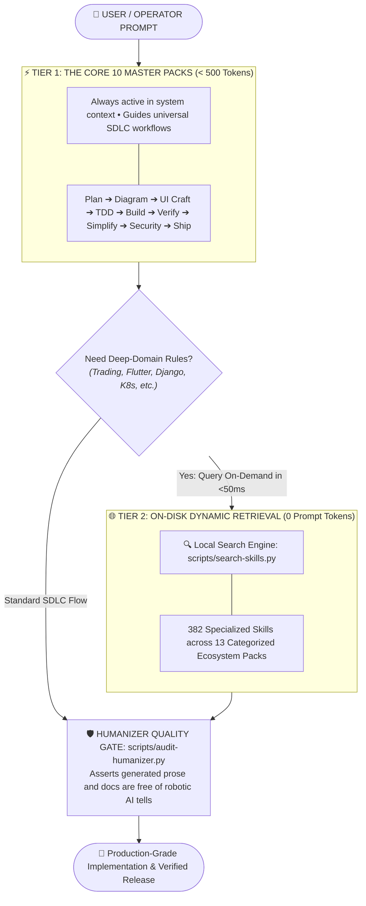

# ⚡ HyperCraft: Autonomous Engineering & Quant Trading Suite

> **The unified, batteries-included engineering distribution for AI coding agents.**  
> Combines architectural planning, editorial visuals, design intelligence, anti-slop UI craft, strict TDD, algorithmic quant trading, and production API hardening under one cohesive standard.

[](https://github.com/0xdevhero/hypercraft-skills/actions)
[](LICENSE)
[](#-ecosystem-domains-skillsecosystem)
[](#-why-hypercraft-the-token-crisis-solved)
[](#-trading--quant-suite-skillsecosystemtrading)
[](#-specialized-agent-roster-agents)
[](https://github.com/sponsors/0xdevhero)
[](https://www.buymeacoffee.com/hrhero)
[](#-installation--quickstart)

---

## 💥 Why HyperCraft? The Token Crisis Solved

When developers dump hundreds of individual skill files into AI coding agent environments (Claude Code, Antigravity, Cursor), they face three immediate problems:

1. **The 25,000-Token Tax:** Injecting 400 loose skill definitions burns **20,000 to 25,000 tokens** on every turn before you even submit your prompt.
2. **Silently Dropped Skills:** Coding agent runners hit strict context budget limits and silently drop over half of your installed skills without warning.
3. **Attention Dilution:** When an LLM evaluates 400 competing descriptions simultaneously, decision quality degrades, leading to hallucinated arguments and incorrect tools.

**HyperCraft solves this by restructuring 511 skills into a two-tier hybrid architecture:**

| Evaluation Metric | Traditional Flat Setup (500+ Skills) | HyperCraft Hybrid Architecture | Developer Benefit |
|---|:---:|:---:|---|
| **System Prompt Overhead** | 25,000 to 30,000 tokens | **< 500 tokens** | **98% Token Reduction** 🚀 |
| **Skill Availability** | > 60% dropped by context budget | **100% accessible on disk** | Zero dropped skills |
| **Agent Decision Quality** | Confused by 500+ options | **Laser-focused on 10 Core Packs** | Deterministic, bug-free execution |
| **Deep-Domain Access** | Bloats system memory | **Queried on demand via CLI in 50ms** | Zero-token prompt bloat |
| **Attribution & Hygiene** | Fragmented author watermarks | **100% clean Apache-2.0 standard** | Enterprise-safe distribution |

---

## 🏛️ The Architecture



📖 **[Read the Full Technical Architecture Guide (docs/HOW_IT_WORKS.md)](docs/HOW_IT_WORKS.md)**

---

## ⚡ The 10 Core Master Skills (`skills/`)

Always active by default. Lightweight, universal, and comprehensive:

| Master Skill | Capabilities & Value |
|---|---|
| **`hyper-plan`** | RFC-style task planning, acceptance criteria, milestone mapping, and scope bounding. |
| **`hyper-diagram`** | Stripe and Linear publication-grade architectural diagrams (C4, ERD, Sequence, State machines). |
| **`hyper-ui-intelligence`** | Local BM25 design search: 192 domain palettes, 59 typography pairings, and 99 UI recipes. |
| **`hyper-ui-craft`** | Modern editorial web aesthetics: anti-slop CSS, fluid typography, dark-mode glassmorphism, and micro-interactions. |
| **`hyper-tdd`** | Strict Red-Green-Refactor loop. Writes reproducible tests first, proves failure, then implements to green. |
| **`hyper-build`** | Atomic incremental compiler and build resolver. Minimal diffs; zero intermediate breakage. |
| **`hyper-verify`** | Independent verification gate. Audits boundary contracts, silent exceptions, and test coverage before commit. |
| **`hyper-simplify`** | Behavior-preserving refactoring. Eliminates dead code, collapses cyclomatic complexity, and flattens nesting. |
| **`hyper-security`** | OWASP Top 10 hardening, BOLA defenses, JWT validation, strict CORS policies, and rate-limiting. |
| **`hyper-ship`** | Semantic releases, Conventional Commits, changelog generation, and pre-push verification. |

---

## 📈 Trading & Quant Suite (`ecosystem/trading/`)

A production-grade algorithmic and quantitative trading suite for AI agents:

| Skill | Description |
|---|---|
| **`trading-quant-indicators`** | Vectorized oscillators (RSI, MACD, Bollinger Bands, ATR, EMA, VWAP) and Smart Money Concepts (Fair Value Gaps, Order Blocks, Liquidity Sweeps) via pandas. |
| **`trading-backtesting-engine`** | Quantitative backtesting pipeline with fee and dynamic slippage modeling, Sharpe/Sortino ratios, and Max Drawdown calculations. |
| **`trading-exchange-connectors`** | Unified execution via CCXT for 100+ crypto exchanges (Binance, Bybit, OKX) and Alpaca API for US equities. Bracket and OCO orders. |
| **`trading-risk-management`** | Capital preservation framework: Kelly Criterion, 1% fixed fractional risk, portfolio heat caps, and automated emergency kill switch. |
| **`trading-sentiment-intelligence`** | Crypto Fear & Greed index integration, perpetual funding rate squeeze detection, and high-impact macro calendar gating (FOMC/CPI). |
| **`trading-agent-security`** | Financial prompt injection defense, spend limits, pre-send transaction simulations, and wallet isolation. |
| **`trading-defi-amm-security`** | On-chain DEX protection, MEV sandwich defense, and slippage guards. |
| **`trading-evm-token-decimals`** | High-precision floating point math protection for EVM token calculations. |
| **`trading-prediction-market-risk`** | Risk management for event-driven contracts (Polymarket, Kalshi). |
| **`trading-prediction-oracle-research`** | Oracle resolution analysis and cross-venue probability arbitrage. |

---

## 🌐 Ecosystem Domains (`ecosystem/`)

HyperCraft categorizes 501 specialized domain skills across 14 engineering disciplines:

- **`trading/`**: 10 Quant, algorithmic trading, exchange execution, and bot security skills.
- **`languages/`**: 41 skills covering Python, Go, Rust, Dart, Flutter, Swift, Kotlin, C++, C#, and Modern Perl.
- **`frameworks/`**: 56 skills for React 19, Next.js, Vue 3, Nuxt 4, Flutter UI, Firebase Suite, Laravel, Django, Spring Boot, NestJS, and Ktor.
- **`databases/`**: 9 skills covering PostgreSQL, MySQL, Redis, ClickHouse, Cloud Databases, BigQuery, and JPA/Hibernate.
- **`devops-cloud/`**: 25 skills for Docker, Kubernetes, CI/CD pipelines, GCP Observability, Uncloud, Cisco IOS, and Homelab.
- **`security/`**: 10 skills covering Deep Auth, BOLA, JWT, CORS, Rate-Limiting, and HIPAA compliance.
- **`multimedia-3d/`**: 12 skills for Three.js WebGL, GSAP, Framer Motion, Spline 3D, Remotion, and Manim.
- **`agentic-ai/`**: 45 skills for Autonomous loops, DevFleet, DMUX multi-agent worktrees, Antigravity SDK, and autonomous runtime systems.
- **`science-bio/`**: 53 skills for PubChem, ChEMBL, AlphaFold, Biomolecular Viewer, ClinVar, GTEx, and NCBI pipelines.
- **`testing-qa/`**: 21 skills for Playwright E2E, Windows native desktop UI automation, and CodeScene Health.
- **`architecture-sdlc/`**: 33 skills for Clean Architecture, Hexagonal patterns, API contracts, and ADRs.
- **`frontend-ui/`**: 18 skills for Hallmark anti-AI design, Accessible components, Tailwindcss-motion, and React Bits dynamic canvases.
- **`tools-workflow/`**: 167 skills for Chrome DevTools, Google Workspace, Git workflows, Jira integration, Conventional Commits, and token tracking.
- **`backend-api/`**: 1 core pattern skill for production API design.

---

## 🛠️ Built-in Developer Tooling

HyperCraft includes standalone, zero-dependency CLI tools ready for immediate use:

### 1. Instant On-Disk Skill Search (`scripts/search-skills.py`)
Retrieve relevant deep-domain skills in milliseconds without adding tokens to the system prompt:
```bash
# Search for technical indicators
python scripts/search-skills.py "quant indicators"

# Search for Flutter routing
python scripts/search-skills.py "declarative routing" --category languages

# Search for Celery background tasks
python scripts/search-skills.py "celery async tasks" --category frameworks
```

### 2. Humanizer Prose Auditor (`scripts/audit-humanizer.py`)
Audit your documentation and prose against AI writing patterns, buzzwords, and stylistic artifacts:
```bash
# Audit repository documentation
python scripts/audit-humanizer.py

# Audit any specific markdown file
python scripts/audit-humanizer.py path/to/document.md
```

### 3. Watermark Remover (`scripts/scrub-watermarks.py`)
Audit and clean residual third-party developer watermarks, handles, and promotional links from cloned repositories:
```bash
# Preview detections without modifying
python scripts/scrub-watermarks.py path/to/repo --dry-run

# Clean all files and rebrand
python scripts/scrub-watermarks.py path/to/repo --brand "HyperCraft Core Team"
```

---

## 🤖 Specialized Agent Roster (`agents/`)

HyperCraft ships with **76 autonomous, specialized agent personas** across architecture, multi-language code review, build resolution, and application security:

### 👑 Core Master Personas
| Persona | Role | Focus |
|---|---|---|
| **`hyper-architect`** | Principal Systems Architect | System decomposition, capability maps, contracts, and RFC plans. |
| **`hyper-designer`** | Staff Product Designer | Modern editorial aesthetics, color harmony, typography pairings, and zero-slop UI. |
| **`hyper-security-auditor`** | Lead AppSec Engineer | OWASP Top 10, financial prompt injection, threat modeling, and cryptographic integrity. |
| **`hyper-reviewer`** | Principal Code Reviewer | Cyclomatic reduction, memory leak detection, immutability, and zero regression. |

### 🛠️ Specialized Full-Stack Roster (72 Agents)
- **Language Reviewers (11)**: `typescript-reviewer`, `python-reviewer`, `go-reviewer`, `rust-reviewer`, `swift-reviewer`, `kotlin-reviewer`, `cpp-reviewer`, `csharp-reviewer`, `php-reviewer`, `ruby-reviewer`, `bengali-reviewer`.
- **Framework & Database Reviewers (8)**: `react-reviewer`, `vue-reviewer`, `django-reviewer`, `fastapi-reviewer`, `flutter-reviewer`, `database-reviewer`, `mle-reviewer`, `healthcare-reviewer`.
- **Compiler & Build Error Resolvers (11)**: `build-error-resolver`, `react-build-resolver`, `go-build-resolver`, `rust-build-resolver`, `swift-build-resolver`, `kotlin-build-resolver`, `dart-build-resolver`, `cpp-build-resolver`, `django-build-resolver`, `java-build-resolver`, `pytorch-build-resolver`.
- **Quality, TDD & Security (14)**: `tdd-guide`, `security-reviewer`, `silent-failure-hunter`, `performance-optimizer`, `pr-test-analyzer`, `commit-reviewer`, `e2e-runner`, `refactor-cleaner`, `spec-miner`, `chief-of-staff`, `planner`, `code-explorer`, `code-simplifier`, `doc-updater`.
- **Domain Specialists (28)**: `firestore-rules-author`, `flutter_a11y_agent`, `network-architect`, `network-config-reviewer`, `network-troubleshooter`, `homelab-architect`, `seo-specialist`, `marketing-agent`, `rag-pipeline-reviewer`, `harness-optimizer`, `loop-operator`, `agent-evaluator`, `gan-planner`, `gan-generator`, `gan-evaluator`, and more.

---

## 🚀 Installation & Quickstart

### 1. Google Antigravity
Clone directly into your configuration directory:
```bash
git clone https://github.com/0xdevhero/hypercraft-skills.git ~/.gemini/config/plugins/hypercraft-skills
```

### 2. Claude Code
Install as a workspace plugin:
```bash
claude plugin add https://github.com/0xdevhero/hypercraft-skills
```

### 3. Cursor & Windsurf
Add to your project root or workspace rules:
```bash
git submodule add https://github.com/0xdevhero/hypercraft-skills.git .agents/hypercraft
```

---

## 💖 Sponsorship & Support

HyperCraft is an open-source initiative providing a zero-token-tax engineering distribution for modern coding agents. If HyperCraft accelerates your daily workflow or helps your engineering team build faster, consider supporting our development:

- **Buy Me a Coffee:** [Support hrhero on Buy Me a Coffee](https://www.buymeacoffee.com/hrhero)
- **GitHub Sponsors:** [Become a Sponsor](https://github.com/sponsors/0xdevhero)
- **Feature Bounties and Custom Agent Packs:** Open an issue with the sponsorship label or contact the team.

Your support funds continuous benchmarking, testing against new model releases, and expanding deep-domain ecosystem packs.

---

## 🤝 Community & Contributing

We welcome community improvements, new language packs, and quant trading strategies! Please review:
- [Contributing Guidelines](CONTRIBUTING.md)
- [Code of Conduct](CODE_OF_CONDUCT.md)
- [Security Policy](SECURITY.md)

---

## 📄 License

Distributed under the **Apache 2.0 License**. See [LICENSE](LICENSE) for details.  
Maintained by the **HyperCraft Core Team** ([0xdevhero](https://github.com/0xdevhero)).
