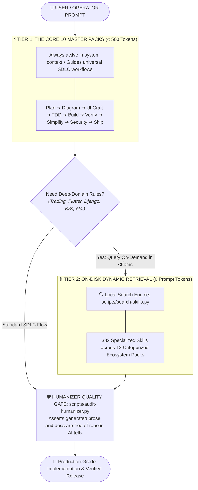

# 📖 How HyperCraft Works: Operational Architecture & Workflows

This document explains the technical architecture, execution flow, and operational patterns behind the **HyperCraft Autonomous Engineering & Quant Trading Suite**.

---

## 🏛️ 1. High-Level System Architecture

Most AI coding setups suffer from two failure modes:
1. **Context Window Exhaustion:** Loading hundreds of skill descriptions into the system prompt consumes 20,000+ tokens before the user even types a prompt.
2. **Attention Dilution:** When an LLM faces 400 competing skill definitions, it hallucinates tool arguments and selects inappropriate instructions.

HyperCraft eliminates this with a **Two-Tier Hybrid Architecture**:



---

## ⚡ 2. How the Core 10 Master Skills Work in Sequence

The 10 Core Master Skills form a deterministic, end-to-end software development lifecycle. They can be invoked individually or chained together:

### Phase 1: Planning (`hyper-plan`)
- **What it does:** Replaces ambiguous prompts with structured RFC specifications.
- **Workflow:**
  1. Identifies core requirements and non-goals.
  2. Creates a capability breakdown tree.
  3. Establishes unambiguous acceptance criteria and verification gates before any code is written.

### Phase 2: System Architecture & Visuals (`hyper-diagram`)
- **What it does:** Generates publication-grade technical visuals using inline SVG and self-contained HTML (Stripe and Linear aesthetic).
- **Workflow:**
  1. Maps relationships using 50 diagram types (C4 containers, Sequence, ERD, State machines, Data pipelines).
  2. Implements a consistent dark-mode design system with legible typography and zero diagram layout bugs.

### Phase 3: Design Intelligence & UI Engineering (`hyper-ui-intelligence` + `hyper-ui-craft`)
- **What it does:** Delivers anti-slop frontend engineering without generic AI templates.
- **Workflow:**
  1. `hyper-ui-intelligence` uses an on-disk BM25 search engine to fetch exact color harmonies from 192 domain palettes, 59 typography pairings, and 99 UI recipes.
  2. `hyper-ui-craft` translates palettes into clean Tailwind CSS, Framer Motion transitions, and accessible UI components with zero layout shifts.

### Phase 4: Implementation & Test-Driven Development (`hyper-tdd` + `hyper-build`)
- **What it does:** Prevents broken multi-file diffs and hallucinated logic.
- **Workflow:**
  1. `hyper-tdd` enforces the strict Red-Green-Refactor loop: writes a reproducible test first, runs it to prove failure, then writes the minimum implementation to pass.
  2. `hyper-build` executes changes in atomic vertical slices (maximum 100 lines per verified step), running the compiler after every step to catch errors early.

### Phase 5: Verification & Simplification (`hyper-verify` + `hyper-simplify`)
- **What it does:** Eliminates silent regressions, dead code, and unnecessary complexity.
- **Workflow:**
  1. `hyper-verify` audits boundary conditions, checks for swallowed exceptions, and measures real test coverage before allowing a commit.
  2. `hyper-simplify` performs behavior-preserving refactoring: collapses nested loops, removes dead functions, and flattens cyclomatic complexity while keeping all tests green.

### Phase 6: Production Hardening (`hyper-security`)
- **What it does:** Audits endpoints and data stores against real-world vulnerabilities.
- **Workflow:**
  1. Audits against OWASP Top 10 API vulnerabilities (Broken Object Level Authorization, Broken Authentication, Mass Assignment).
  2. Enforces JWT signature validation, strict CORS origin whitelisting, rate-limiting readiness, and input sanitization.

### Phase 7: Semantic Shipping (`hyper-ship`)
- **What it does:** Automates release preparation.
- **Workflow:**
  1. Verifies the Git staging area and drafts Conventional Commits (`feat:`, `fix:`, `refactor:`).
  2. Updates changelogs and confirms automated CI checks pass before push.

---

## 📈 3. How the Trading & Quant Suite Works

Located in `ecosystem/trading/`, this pack provides mathematical formulas, execution connectors, and risk-management guardrails for algorithmic trading.

### 1. Mathematical Indicators & SMC (`trading-quant-indicators`)
- **Formula Implementation:** Vectorized calculations for RSI, MACD, Bollinger Bands, ATR, Supertrend, and Volume-Weighted Average Price (VWAP).
- **Smart Money Concepts (SMC):** Detects Fair Value Gaps (FVG), Order Blocks (OB), and Liquidity Sweeps on historical OHLCV dataframes using pandas.

### 2. Strategy Backtesting Engine (`trading-backtesting-engine`)
- **Execution Modeling:** Shifts signals by 1 bar to strictly eliminate look-ahead bias.
- **Fee & Slippage Modeling:** Deducts round-trip exchange fees (maker/taker) and dynamic slippage based on market volatility.
- **Metrics Computed:** Sharpe Ratio, Sortino Ratio, Maximum Drawdown (MDD), Profit Factor, and Expectancy Payoff.

### 3. Unified Exchange Connectors (`trading-exchange-connectors`)
- **Crypto (CCXT):** Connects to 100+ exchanges (Binance, Bybit, OKX, Kraken) with built-in rate-limit compliance, sandbox mode, and WebSocket order book feeds.
- **Equities (Alpaca):** Places Market, Limit, Stop-Loss, and One-Cancels-the-Other (OCO) bracket orders with idempotency tokens.

### 4. Capital Preservation & Kill Switch (`trading-risk-management`)
- **Position Sizing:** Implements Quarter-Kelly Criterion and Fixed Fractional (1% risk model) sizing:
  `Units = (Account Equity * Risk %) / abs(Entry Price - Stop Loss Price)`
- **Automated Emergency Kill Switch:** If account drawdown exceeds 3% within a rolling 24-hour window, the system cancels all open limit orders, closes or hedges exposures, and locks execution until the next session.

### 5. Sentiment & News Gating (`trading-sentiment-intelligence`)
- **Real-Time Sentiment:** Fetches the Crypto Fear & Greed Index from the Alternative.me API.
- **Funding Rate Analysis:** Monitors perpetual futures funding rates to detect overleveraged short/long squeeze conditions.
- **Economic Calendar Blackout:** Gating rule that freezes automated trade entries 15 minutes before and 30 minutes after major economic events (FOMC, CPI, Non-Farm Payrolls).

### 6. Bot Security Guardrails (`trading-agent-security` + `trading-defi-amm-security`)
- **Financial Prompt Injection Defense:** Regex filters that catch malicious override instructions (e.g. `send all funds to 0x...`).
- **DeFi & MEV Protection:** Enforces minimum return parameters on DEX swaps (Uniswap/Raydium) to prevent frontrunning and sandwich attacks.

---

## 🔍 4. How the On-Disk Skill Search Engine Works (`scripts/search-skills.py`)

The on-disk search engine allows agents to access deep-domain knowledge without bloating the system prompt.

### The Scoring Algorithm
When an agent runs:
```bash
python scripts/search-skills.py "query keywords"
```
The search script:
1. Crawls all `SKILL.md` files under `skills/` and `ecosystem/`.
2. Evaluates relevance using weighted scoring:
   - **Exact name match:** 100 points
   - **Partial name match:** 40 points
   - **Category match:** 25 points
   - **Frontmatter description match:** 20 points
   - **Body occurrence frequency:** Up to 30 points
   - **Core pack bonus:** 5 points
3. Returns the top matching skills with file location and exact relevant code excerpts in under 50 milliseconds.

### Usage Examples
```bash
# Search for technical indicator recipes
python scripts/search-skills.py "quant indicators"

# Search for Flutter navigation patterns
python scripts/search-skills.py "declarative routing" --category languages

# Search for Celery async jobs in Django
python scripts/search-skills.py "celery async tasks" --category frameworks
```

---

## ✍️ 5. How the Humanizer Engine & Auditor Works (`scripts/audit-humanizer.py`)

The Humanizer engine (`ecosystem/tools-workflow/humanizer/SKILL.md`) removes robotic, generic AI writing patterns and ensures all prose reads naturally.

### The 6 Detection Criteria
1. **Stock AI Words:** Detects overused buzzwords (such as conversational filler, overused hype adjectives, and dramatic marketing superlatives).
2. **Excessive Em-Dashes:** Flags overuse of em-dashes (`—`) that models use to force sentence rhythm.
3. **Chat Wrappers & Staged Openers:** Catches filler prefixes (`Certainly!`, `In today's fast-paced world`, `To summarize`).
4. **Not-X-but-Y Contrasts:** Detects artificial rhetorical contrasts (such as artificial dichotomies where one side only exists to inflate importance).
5. **Bold Labels Everywhere:** Flags repetitive bolding of the first words in bullet lists.
6. **False Triads:** Flags forced groupings of three adjectives or verbs that add no real meaning.

### Running the Auditor
```bash
# Audit core repository documentation
python scripts/audit-humanizer.py

# Audit any specific file
python scripts/audit-humanizer.py path/to/document.md

# Audit an entire folder
python scripts/audit-humanizer.py path/to/folder/
```
The script outputs a score out of 100, specific line numbers, and actionable remediation notes.

---

## 🚀 6. Summary of Daily Agent Usage

| Need | What to Use | Execution Command |
|---|---|---|
| **Build a new feature end-to-end** | Core 10 SDLC Loop | Follow `hyper-plan` through `hyper-ship` |
| **Create architectural diagrams** | `hyper-diagram` | Reference `skills/hyper-diagram/SKILL.md` |
| **Search 400+ domain skills** | Search CLI | `python scripts/search-skills.py "<topic>"` |
| **Develop algorithmic trading bots** | Trading & Quant Suite | Reference `ecosystem/trading/` |
| **Verify natural human prose** | Humanizer Auditor | `python scripts/audit-humanizer.py <file>` |
| **Validate all repository skills** | CI Verification | `python scripts/search-skills.py --help` & test runner |
